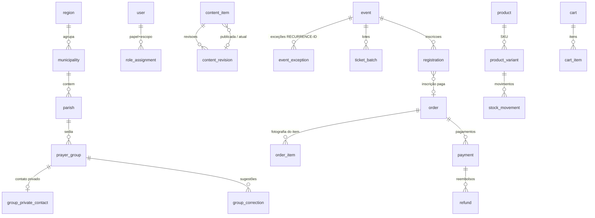

# Modelo de dados

Fonte: `src/db/schema.ts` (Drizzle) → migrações em `drizzle/`. 37 tabelas. Convenções: instantes `timestamptz` (UTC), datas de dia inteiro `date`, dinheiro em centavos `integer` (BRL), tokens públicos opacos separados das chaves.

## Dicionário (resumo por área)

| Tabela | Finalidade | Regras de integridade principais |
|---|---|---|
| `user`, `session`, `account`, `verification`, `two_factor`, `rate_limit` | Autenticação (better-auth) | e-mail único; sessão por token único; `active=false` bloqueia acesso |
| `role_assignment` | Papel + escopo (global/região/grupo/ministério) | único por (usuário, papel, escopo); escopo global ⇔ `scope_id` nulo |
| `institution` | Dados institucionais (linha única) | `id = 1`; `confirmed` indica se foi validado |
| `region`, `municipality`, `parish` | Território (regiões opcionais) | slugs únicos |
| `prayer_group` | Dados públicos do grupo | dia 0–6; `published`; `last_confirmed_at` (desatualizado > 180 dias) |
| `group_private_contact` | Dados do coordenador | nunca lido por consultas públicas; telefone só com `phone_publication_authorized` |
| `group_correction` | Sugestões de visitantes | moderadas; não alteram o grupo |
| `ministry` | Ministérios | slug único |
| `content_item` / `content_revision` | Conteúdo e versões | aprovação pertence à revisão; `published_revision_id` separado de `current_revision_id` |
| `media` | Arquivos | `alt` obrigatório para imagem não decorativa; `is_private` |
| `event` | Eventos | forma de horário consistente (dia inteiro × horário); UID iCal único; (fonte, id externo) único |
| `event_exception` | Ocorrências canceladas/alteradas | único por (evento, início original) |
| `ticket_batch` | Lotes | preço ≥ 0 |
| `registration` | Inscrições | token público único; chave de idempotência única |
| `prayer_request` | Pedidos de oração | `delete_after` obrigatório (expurgo automático) |
| `product`, `product_variant`, `stock_movement` | Catálogo e estoque | `0 ≤ reservado ≤ em estoque`; baixa de venda única por (variante, pedido) |
| `cart`, `cart_item` | Carrinho | token opaco; quantidade 1–20 |
| `order`, `order_item` | Pedidos | total = subtotal − desconto + frete; moeda BRL; estados separados de pedido/pagamento/entrega |
| `payment`, `refund` | Pagamentos | (provedor, id) único; reembolsado ≤ valor |
| `exception_case` | Fila de exceções | decisão humana |
| `webhook_inbox` | Deduplicação de webhooks | (provedor, id do evento) único |
| `job` | Fila durável | dedupe único entre jobs ativos |
| `integration_state` | Tokens de sincronização, último sucesso/erro | — |
| `audit_log` | Auditoria | **somente inclusão** (triggers) + cadeia SHA-256 |

## Retenção proposta (validar com o encarregado de dados)

| Categoria | Proposta |
|---|---|
| Pedidos de oração | exclusão automática em 60 dias |
| Inscrições | anonimizar 12 meses após o evento (não implementado) |
| Sugestões de correção | excluir 12 meses após moderação (não implementado) |
| Pedidos e pagamentos | conforme obrigação fiscal/contábil a definir; sem exclusão automática |
| Logs operacionais | 30 dias · Auditoria: 180 dias (proposta) |
| Carrinhos | expiram em 30 dias |
